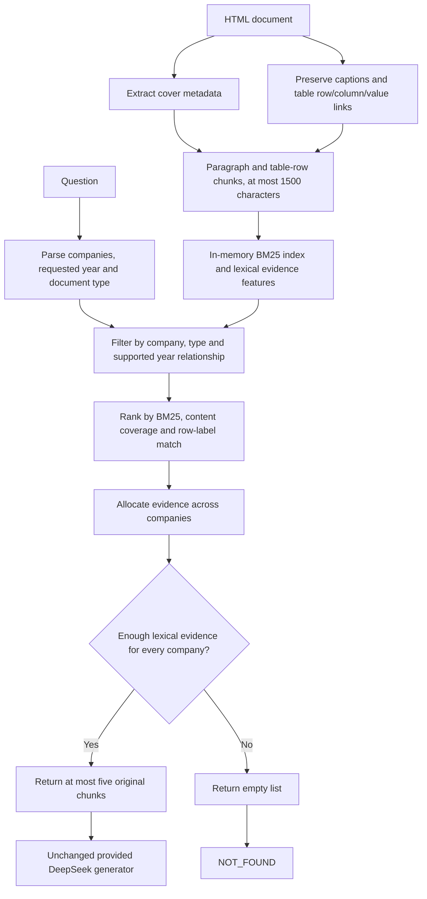

# FTEC5660-HW4

Retrieval over HTML company reports for SEEM5660 Homework 4. The five student functions are implemented in `hw4.py`; the provided generator, loaders, runner and scoring code are unchanged.

## Setup and execution

Use Python 3.10 or newer (development uses Python 3.12). The Windows system Python 3.9 is too old.

For this local checkout, `.venv` has been prepared with the bundled Python 3.12 interpreter. Use `.\.venv\Scripts\python.exe` directly. On another machine, first select a Python 3.10+ interpreter before creating the environment. `requirements-lock.txt` records the exact development package versions; use it to reproduce that environment if needed.

```powershell
python -m venv .venv
.\.venv\Scripts\python.exe -m pip install -r requirements.txt
# Create .env locally with DEEPSEEK_API_KEY=your_key
.\.venv\Scripts\python.exe hw4.py --data-folder public_test --output results.csv
```

On macOS/Linux use `.venv/bin/python` instead. The official command calls the supplied DeepSeek generator and incurs API charges. `.env`, virtual environments and serialized index files are ignored by Git. Never put a real key in `.env.example` or commit it elsewhere.

```powershell
# No model calls: contracts, public-data retrieval, and all ablations
.\.venv\Scripts\python.exe -m unittest -v test_hw4 test_robustness
.\.venv\Scripts\python.exe evaluate.py --offline

# Full ablations: calls only the provided generator; requires the API key
.\.venv\Scripts\python.exe evaluate.py
.\.venv\Scripts\python.exe update_report.py
```

`evaluate.py --variants V6 --offline` runs only the final retrieval configuration. Each run stores per-question results, retrieved passages, aggregate metrics and code hashes under `experiments/offline/` or `experiments/full/`. Offline accuracy cells are intentionally empty: retrieval recall is not answer accuracy. These evaluation files may contain public labels for analysis; `hw4.py` never reads them.

## Homework 4 solution

### Official evaluation and reproducibility

The post-audit candidate answers **60/60 public questions correctly**, scoring **75/75 automatic points** (Tasks 1--4). The official run takes **8.5 seconds** including index construction and generation. The pre-audit baseline was also 75/75 and took 7.8 seconds; this audit improves tested robustness rather than the already-saturated public score. Student LLM usage is zero. The supplied generator makes 46 calls with 21,584 input and 166 output tokens; estimated cost is USD 0.0033 using the provided runner's constants, not a verified bill.

A fresh remote clone with the candidate files overlaid and a **new virtual environment installed from `requirements.txt`** also answers 60/60 correctly in 9.2 seconds. All 19 regression/robustness tests pass in that environment. No index or credential file was copied; the API key was supplied through the child process environment. The technical audit was completed before the final reflection revision. See `AUDIT_REPORT.md`, `audit/clean-check.json`, `audit/install.log`, `experiments/official/run.log` and root `results.csv` for evidence. The pre-audit baseline is preserved under `audit/before/`. These checks cover the reviewed candidate. Public-set scores do not establish a private-set grade or TA score. See `SUBMISSION_FILES.md` for the final file layout and exclusions.

### Pipeline



The parser obtains the company, report fiscal year and document type from the cover rather than from file names. Table conversion attaches each original value to its row and column labels, retaining captions and units. Each narrative paragraph and converted table row becomes a bounded chunk with a short source-derived company/year/section header. BM25 uses lowercase whitespace tokens. Query grammar extracts subject companies, including unknown names, and distinguishes the question year from the report year. Annual-report filtering admits the requested year and the following report's comparative column; officer and auditor questions require the requested report year. Research and call passages may support future years explicitly present in their text. Ranking adds normalized query-term coverage, table evidence and row-label matches. Round-robin selection reserves space for each comparison company, then the selected chunks are returned in descending relevance order. The final configuration rejects unknown companies, questions without sufficient lexical evidence for every requested company, and explicit missing-disclosure statements scoped to the requested metric. The index is rebuilt entirely from supplied chunks and has no cross-corpus mutable state. Student code makes no LLM calls; only the supplied generator does.

### Ablation protocol

Every row changes one component relative to the preceding row. The implementations share the same evaluation helpers and the unchanged supplied generator.

| Variant | Single change |
|---|---|
| B0 | Required naive baseline: BeautifulSoup `get_text()`, recursive splitting (1000 characters, overlap 150), required metadata, whole-corpus BM25 with lowercase whitespace tokens, top-5, no query parsing, never abstain |
| V1 | Convert tables with `table_to_text` before the same text extraction and splitting |
| V2 | Replace recursive splitting with paragraph/table-row chunks; retain table captions but omit contextual headers |
| V2H | Add the source-derived company/year/section header to the same chunk boundaries |
| V3 | Add query parsing and company/type/year filtering |
| V4 | Allocate retrieval slots across the requested companies |
| V5 | Add an evidence-ranking component using normalized term coverage, row-label overlap and table/year features |
| V6 | Add lexical abstention: reject missing companies and explicit nondisclosure, and require at least 80% content-term coverage in retained evidence for each company |

Filtering can produce an empty candidate set from V3 onward. The explicit coverage-based rejection rule is introduced only in V6. The 80% threshold and ranking weights are heuristic design choices, not calibrated probabilities. No company names, source file names, public answers or question IDs are embedded in retrieval logic.

<!-- MEASURED_RESULTS -->
#### Measured offline results

| Variant | Recall@5 | Kept | Rejected | Answer accuracy | Seconds |
|---|---:|---:|---:|---:|---:|
| B0 | 19.6% | 100.0% | 0.0% | Not run | 1.15 |
| V1 | 21.7% | 100.0% | 0.0% | Not run | 1.67 |
| V2 | 10.9% | 100.0% | 0.0% | Not run | 2.65 |
| V2H | 45.7% | 100.0% | 0.0% | Not run | 2.74 |
| V3 | 69.6% | 100.0% | 71.4% | Not run | 3.84 |
| V4 | 82.6% | 100.0% | 71.4% | Not run | 3.78 |
| V5 | 100.0% | 100.0% | 71.4% | Not run | 4.08 |
| V6 | 100.0% | 100.0% | 100.0% | Not run | 4.00 |

Source: `experiments/offline/<variant>/results.csv` and `summary.json`. Times include loading, indexing and retrieval; full-mode times also include generation. Offline times exclude generation and do not verify the official end-to-end time limit.

- V1 relative to B0: recall changes by +2.2 percentage points; kept changes from 100.0% to 100.0%, and rejected from 0.0% to 0.0%.
- V2 relative to V1: recall changes by -10.9 percentage points; kept changes from 100.0% to 100.0%, and rejected from 0.0% to 0.0%.
- V2H relative to V2: recall changes by +34.8 percentage points; kept changes from 100.0% to 100.0%, and rejected from 0.0% to 0.0%.
- V3 relative to V2H: recall changes by +23.9 percentage points; kept changes from 100.0% to 100.0%, and rejected from 0.0% to 71.4%.
- V4 relative to V3: recall changes by +13.0 percentage points; kept changes from 100.0% to 100.0%, and rejected from 71.4% to 71.4%.
- V5 relative to V4: recall changes by +17.4 percentage points; kept changes from 100.0% to 100.0%, and rejected from 71.4% to 71.4%.
- V6 relative to V5: recall changes by +0.0 percentage points; kept changes from 100.0% to 100.0%, and rejected from 71.4% to 100.0%.

Final helper checks: table score 100.0%; document pass rate 100.0%; query-field accuracy 100.0%; valid nonempty retrieval 100.0%; retrieval exceptions 0; generator exceptions 0.

Final retrieval misses: none on this public run.

#### Measured full results

| Variant | Recall@5 | Kept | Rejected | Answer accuracy | Seconds |
|---|---:|---:|---:|---:|---:|
| B0 | 19.6% | 100.0% | 0.0% | 40.0% | 13.88 |
| V1 | 21.7% | 100.0% | 0.0% | 38.3% | 14.07 |
| V2 | 10.9% | 100.0% | 0.0% | 31.7% | 13.70 |
| V2H | 45.7% | 100.0% | 0.0% | 61.7% | 15.44 |
| V3 | 69.6% | 100.0% | 71.4% | 81.7% | 14.95 |
| V4 | 82.6% | 100.0% | 71.4% | 86.7% | 13.48 |
| V5 | 100.0% | 100.0% | 71.4% | 100.0% | 12.59 |
| V6 | 100.0% | 100.0% | 100.0% | 100.0% | 12.39 |

Source: `experiments/full/<variant>/results.csv` and `summary.json`. Times include loading, indexing and retrieval; full-mode times also include generation. Offline times exclude generation and do not verify the official end-to-end time limit.

B0, V1, V2, V2H and V3 retain their actual pre-audit answers and measured times: the evaluator is unchanged, and all 60 questions, parses and ordered source chunks match the current offline run exactly. Original source hashes are preserved. `experiments/reuse-validation.json` records the checked artifacts. V4--V6 were rerun after the audit; historical measurements are not relabelled as new runs.

Final helper checks: table score 100.0%; document pass rate 100.0%; query-field accuracy 100.0%; valid nonempty retrieval 100.0%; retrieval exceptions 0; generator exceptions 0.

Final retrieval misses: none on this public run.

<!-- END_MEASURED_RESULTS -->

### End-to-end ablation interpretation

All eight configurations have actual results from the unchanged provided generator (`deepseek-v4-flash`, temperature 0). Each row contains 60 actual answers and has zero retrieval or generator exceptions. After the audit, V4--V6 were rerun because ordering changed the context for 12 comparison questions. For B0 through V3, all 60 generator inputs were identical to the historical run; their answers, times and original source hashes are preserved with explicit exact-context reuse evidence. Current full retrieval results match the corresponding offline inputs. Experiments are single runs, so small changes should not be interpreted as statistically established effects. The official runner uses eight generation workers and the ablation script uses four, so their wall times are not directly comparable.

- **B0 to V1:** recall rises from 19.6% to 21.7%, but answer accuracy falls from 24/60 to 23/60. Table conversion changes text boundaries and rankings, so it can help one question and hurt another. q042 becomes correct, and q044 correctly changes from an unrelated numeric answer to `NOT_FOUND`; q013, q029 and q059 change from correct answers to `NOT_FOUND`. The results therefore do not support claiming that table conversion alone improved end-to-end accuracy. Some answers are scored correct without a retrieval hit, because the answer and evidence checks measure different properties.
- **V1 to V2:** removing broader passage context while splitting into individual rows reduces accuracy from 23/60 to 19/60. Rows are precise but often lack the company information that whole-corpus BM25 needs. **V2H**, which adds only the source-derived contextual header to those boundaries, recovers accuracy to 37/60.
- **V2H to V3:** explicit query parsing and metadata filtering raise accuracy to 49/60 and reject 10/14 unanswerable questions before generation. This supports separating the target entity and requested year from lexical similarity; comparative-year columns remain eligible rather than filtering only for equal report years.
- **V3 to V4:** reserving evidence for every company raises accuracy to 52/60 and recall from 69.6% to 82.6%. The q021 trace illustrates how a comparison fails when all five slots belong to just one company. Better evidence coverage does not produce a one-for-one increase in accuracy, because the generator can already get some answers right from incomplete or ambiguous contexts.
- **V4 to V5:** evidence-aware ranking raises accuracy to 60/60 and recall to 100%. The q016 trace shows exact gross-profit rows replacing related operating-income and gross-margin prose. This component combines term normalization, coverage and row/table/year scoring; the experiment evaluates that ranking component as a whole, not the independent contribution of each weight.
- **V5 to V6:** accuracy remains 60/60, rather than increasing. V5's generator already returns `NOT_FOUND` for all four undisclosed-metric questions (q019, q025, q033, q039). V6 rejects those questions in retrieval, increasing the retriever's rejection rate from 71.4% to 100% and reducing questions sent to the generator from 50 to 46. Generator input tokens fall from 29,466 to 21,584 (26.7%); this includes removing low-coverage passages from answerable questions as well as skipping the four calls. The gain is earlier abstention and lower context cost, not higher observed answer accuracy.

The final configuration has no answer errors on this public run. Earlier variants and the synthetic regressions provide the error cases; there is no invented final error analysis. Per-question answers, expected answers and retrieved contexts remain available in each variant's `results.csv` and `details.json`. `experiments/full/comparison.csv` includes correct counts, generator token counts and estimated costs. Repeated testing and selection on this small public development set can overestimate generalization, particularly for grammar-based parsing and the coverage threshold.

### Limitations and error analysis

The parser uses English grammatical patterns, so unanticipated wording can miss an entity even when a human would find it clear. Lexical coverage is only a proxy for answerability: a passage may contain the right terms while expressing a different relation, or express the right relation using an unknown synonym. Short table-row chunks preserve precise values but can lose context across rows, and ranking several near-duplicate pieces of evidence can waste the five available slots. Report-year filtering assumes the annual-report structure specified in the assignment; it is not intended as a general financial-document date resolver. The public set is a development set; its scores do not establish private-set performance.

Concrete public failure traces explain the component effects. For q051 (net receivables), B0 and V1 both return unrelated companies' management-discussion passages: converting tables alone does not solve entity selection. For q021 (a cash comparison), V3 fills all five slots with Northgate Robotics evidence; V4 includes Northgate Payments and recovers both required facts. For q016 (gross profit), V4 returns operating/net-income and gross-margin prose, whereas V5 ranks the exact `Gross profit` rows from the two eligible annual reports. For q019 (undisclosed lobbying expenses), V5 finds generic expense rows without the requested disclosure; V6 rejects them. These examples are available in the corresponding `details.json` files. V6 does not improve recall over V5 on this set; its benefit is rejection of the four undisclosed-metric questions. Filtering already rejects the unknown-company and unsupported-year questions in V3.

The negative V2 result is informative: splitting into small rows without repeating context reduces recall from 21.7% to 10.9%. A table row often contains neither its company name nor a document-level section heading, so whole-corpus BM25 cannot reliably associate it with the question's entity. V2H restores that source-derived context and raises recall to 45.7%. Small chunks alone are therefore not an improvement. V1's modest gain from 19.6% to 21.7% likewise shows that preserving table structure does not replace entity filtering. V3 improves recall to 69.6%, V4 to 82.6%, and V5 to 100.0%; the saved failure traces support the company-selection, comparison-coverage and metric-selection explanations above. These are observations on the development set, not causal guarantees for other corpora.

During development, an overly broad document-type regex matched `rating` inside `operating`; word boundaries fixed the misclassification. An initial coverage rule also falsely rejected a repurchase-programme question because `Q4` and `large` were treated as evidence terms. Quarter markers and quantity-question filler are now removed before coverage checks, with a separate invented-company regression test. These are general lexical repairs, not question-ID exceptions.

The focused tests check unknown and similarly named companies, previous-year columns, comparison evidence, casing/legal suffixes, long paragraphs, multi-level table headers, source-only results, reordered documents and two independent corpora in one process. These tests use invented source documents, never private data. They verify the listed cases rather than claiming universal robustness.

### Submission audit changes

The independent fixtures in `test_robustness.py` exposed eight failed assertions across four of ten new test methods in the pre-audit implementation. All ten methods now pass, alongside the nine existing tests. Repairs are limited to grammar-based extraction for metric-of-company questions, employee-count paraphrases and comparisons without a colon; preserving an internal `and` when comparison names use `or`; rejecting explicit nondisclosure clauses for the requested metric; and returning the reserved evidence in relevance order. No public company, question ID or answer was added to the retrieval implementation. The synthetic documents are used only by tests. Ambiguous names, unseen English constructions and nuanced negation remain limitations; these tests are not a proof of unrestricted natural-language understanding.

### Task 6: Reflection

See [the reflection](REFLECTION.md).

## Submission checklist

- [x] Run the unchanged official runner and inspect all 60 rows of `results.csv`.
- [x] Run all eight full ablations and verify their code/configuration hashes and actual results.
- Confirm that the reflection represents your own views before submission.
- Check `git diff`, `git status --short` and `git check-ignore .env`; never commit credentials or an index.
- [x] Run the official evaluation on a clean candidate copy with installed dependencies and no prebuilt index.
- Keep the GitHub repository public during grading and submit its link on Blackboard.
- The handout deadline is 1 December, 23:59 HKT; the handout does not specify a year.
